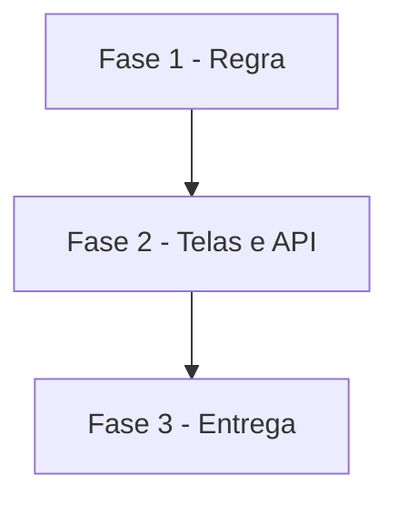

# Tarefas AlfaHome - Dízimo semanal calculado

Escopo: calcular e mostrar o dízimo do mês, conforme `spec.md` e `plan.md` desta pasta.

**Legenda de status:**
- `[ ]` Pendente
- `[~]` Em andamento
- `[x]` Concluido
- `[!]` Bloqueado

**Legenda de criticidade:**
- `[C]` Critico - Impacto financeiro direto ou bloqueante
- `[A]` Alto - Funcionalidade essencial
- `[M]` Medio - Necessario mas sem urgencia imediata

---

## FASE 1 - Regra

### 1.1 Calculo do dizimo `[C]`

Ref: FR-001, FR-002, FR-003

- [x] 1.1.1 `PlanejamentoService::dizimo()` (base, domingos, devido, previsto, devolvido, falta)
- [x] 1.1.2 "Venda de imóvel" reconhecida como receita fixa
- [x] 1.1.3 Testes de regra (domingo, mês seguinte, base, devolvido)

---

## FASE 2 - Telas e API

### 2.1 Card e endpoint `[A]`

Ref: FR-002, FR-003, FR-004

- [x] 2.1.1 Card "Dízimo de {mês}" na tela do mês
- [x] 2.1.2 `GET /api/v1/planejamento/dizimo` + doc da API
- [x] 2.1.3 Testes de tela, API e isolamento

---

## FASE 3 - Entrega

### 3.1 Publicacao e planilha `[M]`

- [ ] 3.1.1 Deploy, conta Ticket, planilha (ticket, dízimos previstos, Venda de imóvel)

---

## Matriz de Dependencias

## Resumo Quantitativo

| Fase | Tarefas | Subtarefas | Criticidade |
|------|---------|------------|-------------|
| 1 - Regra | 1 | 3 | C |
| 2 - Telas e API | 1 | 3 | A |
| 3 - Entrega | 1 | 1 | M |
| **Total** | **3** | **7** | - |

## Escopo Coberto

| Item | Descricao | Fase |
|------|-----------|------|
| US1 | Ver o dízimo do mês | 1, 2 |

## Escopo Excluido

| Item | Descricao | Motivo |
|------|-----------|--------|
| App | Card do dízimo no app | API fica pronta; tela depois |
